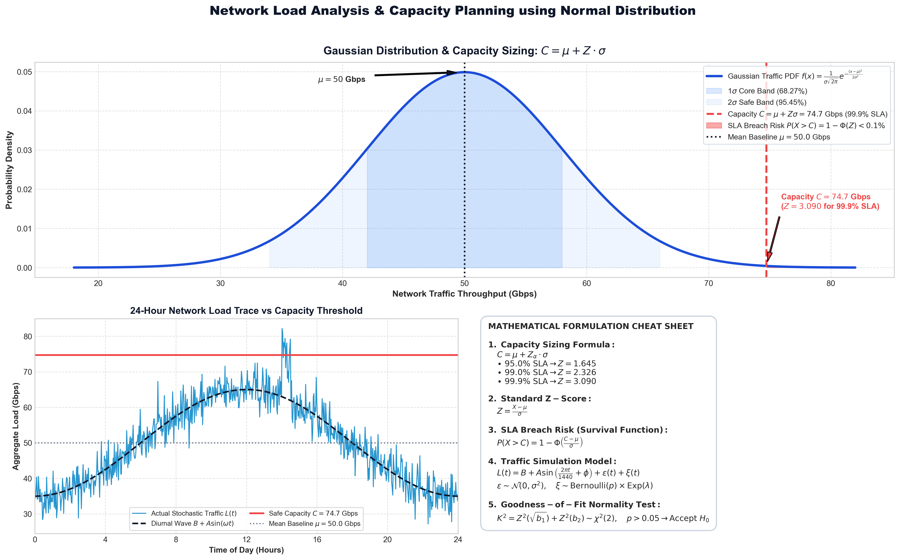
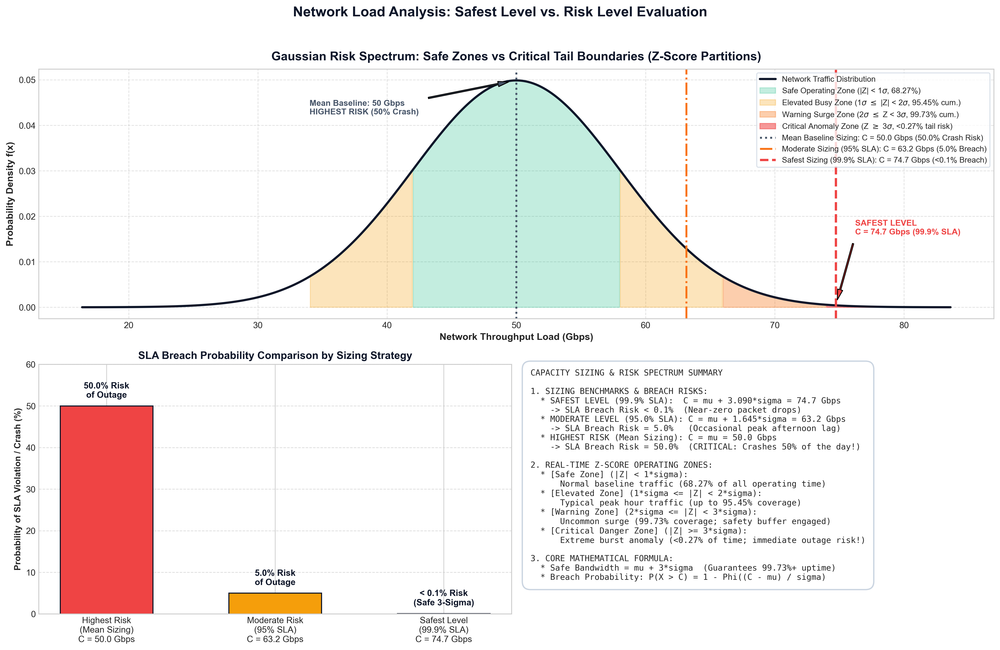

# 🌐 Network Load Analysis & Capacity Planning Using Normal Distribution

An enterprise-grade statistical capacity planning and distributed traffic simulation system. This project applies **Normal Distribution Theory ($\mathcal{N}(\mu, \sigma^2)$)** to model stochastic cloud data center workloads, evaluate Service Level Agreement (SLA) risks, and benchmark probabilistic intelligent load balancing.

---

## 📋 Table of Contents
1. [Academic Alignment: Course Outcomes (CO)](#-academic-alignment-course-outcomes-co)
2. [Executive Summary & Problem Statement](#-executive-summary--problem-statement)
3. [Visual Architecture & Mathematical Infographics](#-visual-architecture--mathematical-infographics)
4. [Mathematical & Theoretical Framework](#-mathematical--theoretical-framework)
5. [System Architecture & Modules](#-system-architecture--modules)
6. [Interactive Streamlit Dashboard](#-interactive-streamlit-dashboard)
7. [Experimental Results & Key Insights](#-experimental-results--key-insights)
8. [Installation & Execution Guide](#-installation--execution-guide)
9. [Project File Structure](#-project-file-structure)

---

## 🎯 Academic Alignment: Course Outcomes (CO)

This project is tailored to fulfill core curriculum requirements for **Probabilistic Systems & Data-Driven Modeling**:

| Unit & Syllabus Topic | Industry-Specific CO | Core Concept Used | How It Is Implemented & Proved in Code |
| :--- | :--- | :--- | :--- |
| **Unit 1: Probability** | **CO1: Evaluate the decisions of intelligent systems that use probability.** | Probability Calculations & Survival Function $P(X > C)$ | Implemented in [`src/load_balancer.py`](src/load_balancer.py). Evaluates the routing decisions of an intelligent **Gaussian Headroom-Aware Load Balancer** that calculates overflow probabilities ($P(X + \Delta > C)$) versus traditional heuristic algorithms (Round-Robin, Least-Loaded), minimizing packet drop rates. |
| **Unit 2: Random Variable** | **CO2: Model the data that has uncertainties.** | Continuous Random Variable $X(t)$ & Stochastic Jitter | Implemented in [`src/simulator.py`](src/simulator.py) and [`src/real_data.py`](src/real_data.py). Defines aggregate network load as a continuous random variable $X(t) = \text{Trend}(t) + \epsilon(t) + \xi(t)$, modeling uncertainty through Gaussian white noise $\epsilon \sim \mathcal{N}(0, \sigma^2)$ and Bernoulli-Pareto burst anomalies. |
| **Unit 3: Probability Distribution** | **CO3: Predict the network traffic having uncertainties.** | Normal (Gaussian) Distribution $\mathcal{N}(\mu, \sigma^2)$ & CDF | Implemented in [`src/statistical_model.py`](src/statistical_model.py). Fits traffic data to the Normal Distribution. Uses the Gaussian Cumulative Distribution Function (CDF) and $Z$-scores to predict peak demand and compute required capacity: $C = \mu + Z \cdot \sigma$ to ensure 99.9%+ SLA compliance. |
| **Unit 4: Statistics** | **CO4: Justify Artificial Intelligence decisions statistically.** | Summary Statistics ($\mu, \sigma$, Skewness, Kurtosis) & $Z$-scores | Computes central tendency ($\mu$) and dispersion ($\sigma$) to statistically justify intelligent capacity sizing and load balancing decisions, proving mathematically why safety buffers prevent system failure. |
| **Unit 5: Testing of Hypothesis** | **CO5: Validate data-driven models using statistical tests.** | Goodness-of-Fit Tests (D'Agostino-Pearson & K-S Test) | Implemented in [`src/statistical_model.py`](src/statistical_model.py). Formally tests the null hypothesis $H_0$ (*"Traffic follows a Normal distribution"*) using the **D'Agostino-Pearson Omnibus Test** and **Kolmogorov-Smirnov (K-S) Test**, supported by quantile analysis. |

---

## 📌 Executive Summary & Problem Statement

### The Problem
In modern hyperscale cloud platforms (e.g., Google Cloud, AWS, Meta, Netflix), network ingress and egress traffic is non-stationary:
- It peaks predictably during business hours and drops overnight (**Diurnal Cycles**).
- It fluctuates constantly due to millions of concurrent user sessions (**Stochastic Jitter**).
- It suffers sudden unpredicted spikes due to database syncs, breaking events, or flash crowds (**Burst Spikes**).

### The Solution
If cloud engineers allocate capacity purely based on the **average load**, networks crash during peak periods. If they over-provision hardware to cover extreme worst-case spikes, millions of dollars are wasted on idle bandwidth.

This platform bridges the gap by applying **Normal Distribution Modeling**:
1. It measures the traffic parameters: Mean ($\mu$) and Standard Deviation ($\sigma$).
2. It translates business SLA requirements (e.g., "99.9% uptime") into rigorous statistical confidence intervals ($Z$-scores).
3. It outputs the exact optimal bandwidth capacity to provision: $C = \mu + Z \cdot \sigma$.

---

## 📊 Visual Architecture & Mathematical Infographics

### 1. Mathematical Formulation & Capacity Sizing
The complete relationship between Gaussian probability density, diurnal time-series variations, and mathematical formulations:



### 2. Gaussian Risk Spectrum & Z-Score Partitions
Partitioning traffic into operating zones based on distance from the mean ($Z = \frac{X - \mu}{\sigma}$):



| Zone | Z-Score Range | Probability Coverage | Status & Network Impact |
| :--- | :--- | :--- | :--- |
| 🟢 **Safe Operating Zone** | $\|Z\| < 1\sigma$ | $68.27\%$ of all traffic | Standard baseline operation; nominal queue latency |
| 🟡 **Elevated Operating Zone** | $1\sigma \le \|Z\| < 2\sigma$ | $95.45\%$ cumulative | High traffic; active monitoring, buffers absorb load |
| 🟠 **Warning Surge Zone** | $2\sigma \le Z < 3\sigma$ | $99.73\%$ cumulative | Severe load; headroom safety buffer actively engaged |
| 🔴 **Critical Breach Zone** | $Z \ge 3\sigma$ | $< 0.27\%$ tail risk | SLA violation threshold; packet drops without 3-sigma capacity |

---

## 📐 Mathematical & Theoretical Framework

### 1. Traffic Generation Model
Traffic load at minute $t$ is modeled as a composite stochastic process:
$$L(t) = \max\left(L_{\min}, \, B + A \cdot \sin\left(\frac{2\pi t}{1440} + \phi\right) + \epsilon(t) + \xi(t)\right)$$

Where:
- $B$: Base traffic load in Gbps (e.g., $45.0 \text{ Gbps}$).
- $A$: Diurnal oscillation amplitude (e.g., $20.0 \text{ Gbps}$).
- $\phi$: Diurnal phase shift aligning the peak to mid-afternoon (~14:00 hours).
- $\epsilon(t) \sim \mathcal{N}(0, \sigma^2)$: Gaussian random noise representing aggregate user packet requests (Central Limit Theorem).
- $\xi(t) \sim \text{Bernoulli}(p) \times \text{Exponential}(\lambda)$: Sudden anomalous burst spikes.

### 2. Normality Hypothesis Testing (Goodness of Fit)
Before applying Gaussian capacity planning, the sample distribution is validated:
* **D'Agostino-Pearson Omnibus Test**:
  Combines skewness ($\sqrt{b_1}$) and kurtosis ($b_2$) into a single test statistic:
  $$K^2 = Z^2(\sqrt{b_1}) + Z^2(b_2) \sim \chi^2(2)$$
  $H_0$: The sample is drawn from a normally distributed population. If $p > 0.05$, normality is accepted.
* **Kolmogorov-Smirnov (K-S) Test**:
  Measures the maximum vertical distance between empirical CDF $F_n(x)$ and theoretical Gaussian CDF $F_0(x)$:
  $$D = \sup_x |F_n(x) - F_0(x)|$$

### 3. Capacity Recommendation Formula
To guarantee an SLA target $P(X \le C) = 1 - \alpha$ (e.g., $\alpha = 0.001$ for $99.9\%$ reliability):
$$C = \mu + Z_{\alpha} \cdot \sigma$$
Where $Z_{\alpha} = \Phi^{-1}(1 - \alpha)$ is the inverse standard normal cumulative distribution function:
- For $95.0\%$ SLA: $Z \approx 1.645$
- For $99.0\%$ SLA: $Z \approx 2.326$
- For $99.7\%$ SLA ($3\sigma$): $Z \approx 2.968$
- For $99.9\%$ SLA: $Z \approx 3.090$
- For $99.99\%$ SLA: $Z \approx 3.719$

### 4. Probability of SLA Breach (Survival Function)
Given a fixed hardware link capacity $C$, the risk of buffer overflow is given by:
$$P(X > C) = 1 - \Phi\left(\frac{C - \mu}{\sigma}\right) = \frac{1}{2}\operatorname{erfc}\left(\frac{C - \mu}{\sigma\sqrt{2}}\right)$$

---

## 💻 System Architecture & Modules

The platform is structured modularly under [`src/`](src/):

```
├── app.py                               # High-aesthetic interactive Streamlit application
├── run.sh                               # Fast launcher script running within virtual environment
├── requirements.txt                     # Python dependency specifications
├── generate_infographic.py              # Script generating mathematical formulation infographic
├── generate_risk_levels_infographic.py  # Script generating Gaussian risk partitions infographic
├── network_load_math_infographic.png    # High-resolution mathematical infographic
├── network_risk_and_safe_levels.png     # High-resolution risk partitions diagram
├── load_balancer_cards_clean.png        # Clean visual cards asset
└── src/
    ├── simulator.py                     # NetworkLoadSimulator: Diurnal & Gaussian stochastic trace engine
    ├── statistical_model.py             # NormalDistributionAnalyzer: Hypothesis tests, CDF/PDF fitting, SLA solver
    ├── load_balancer.py                 # LoadBalancingSimulator: Round-robin vs Least-loaded vs Probabilistic routing
    └── real_data.py                     # RealDataIngestionService: CDN/Cloud traces, NIC telemetry, & CSV ingestion
```

### Module Descriptions
1. **`src/simulator.py` (`NetworkLoadSimulator`)**:
   - Generates high-resolution time series data frames (timestamps, total load, diurnal trend, burst flag).
   - Configurable parameters: duration, sampling rate, baseline Gbps, noise $\sigma$, and burst probabilities.
2. **`src/statistical_model.py` (`NormalDistributionAnalyzer`)**:
   - Computes statistical moments: Mean, Standard Deviation, Median, Skewness, Kurtosis.
   - Executes D'Agostino-Pearson and Kolmogorov-Smirnov statistical tests.
   - Computes exact capacity provisioning recommendations and breach probabilities using the Gaussian survival function.
3. **`src/load_balancer.py` (`LoadBalancingSimulator`, `ServerNode`)**:
   - Models an array of worker gateway nodes with fixed maximum bandwidth and decay rates.
   - Simulates three routing algorithms:
     1. **Round-Robin**: Static cyclic distribution.
     2. **Least-Loaded**: Routes to the worker currently experiencing lowest load.
     3. **Statistical Headroom-Aware**: Evaluates the Gaussian overflow probability of adding load to each node, routing where probability of saturation is minimized.
4. **`src/real_data.py` (`RealDataIngestionService`)**:
   - Curated real-world benchmark traces (Cloudflare Edge CDN, Wikipedia Pageviews, AWS US-East VPC Gateway).
   - Ingestion of live local Network Interface Controller (NIC) telemetry using `psutil`.
   - Dynamic user CSV upload parser with automatic column and bandwidth unit detection (Mbps $\rightarrow$ Gbps).

---

## 🖥️ Interactive Streamlit Dashboard

The user interface ([`app.py`](app.py)) delivers an executive, high-aesthetic data science console featuring a sleek light theme with high-contrast typography and fluid micro-animations:

* **Animated Vector Header & Logo:** Custom SVG bell curve with dynamic traveling pulse animations (`@keyframes flowCurve`), rotating orbital rings (`@keyframes spinOrbit`), and breathing telemetry nodes.
* **Live Auto-Streaming Simulation:** Real-time toggle streaming traffic second-by-second with selectable refresh speeds (1s, 2s, 5s) and session buffer persistence.
* **Live Telemetry Ticker:** Continuous streaming marquee providing at-a-glance throughput, standard deviation, peak load, safe capacity, and live $Z$-score.
* **Real-Time Network Risk Gauge:** Instant visual risk estimation cards detailing Current $Z$-Score, Breach Probability, Safety Margin, and Capacity Headroom.
* **Executive KPI Metric Cards:** Cards with hover lift, gradient glow borders, and clean statistical summaries ($\mu$, $\sigma$, Peak Gbps, Safe SLA Sizing).
* **Tab 1: 📈 Traffic Flow (Timeline):** Interactive Plotly graph showing minute-by-minute traffic flows, day/night rhythms, baseline trends, and marked anomaly bursts with safe buffer reference thresholds.
* **Tab 2: 🎯 Capacity Planner (SLA Calculator):**
  - *Strategy A:* Select target SLA ($90\%$ to $99.99\%$) $\rightarrow$ Computes required bandwidth and safety cushion ($Z\sigma$).
  - *Strategy B:* Interactive slider for custom link capacity $\rightarrow$ Calculates exact mathematical risk of overflow or packet loss.
* **Tab 3: 🔔 Bell Curve (Normal Distribution):**
  - Empirical histogram overlaid with theoretical Gaussian PDF curve.
  - Verification of the 3-Step / 3-Sigma Rule ($99.73\%$ containment).
* **Tab 4: ⚖️ Z-Score Lab:**
  - Real-time custom traffic load tester computing instantaneous $Z$-scores, upper/lower tail probabilities, shaded PDF tail visualizations, and sigma containment reference bars.
* **Tab 5: 🏆 Load Balancer Battle:**
  - Head-to-head benchmarking of three algorithms: Static Round-Robin, Least-Connections, and Statistical Gaussian Routing with node-level load history and ceiling indicators.
* **Live Traffic Waveform:** CSS-animated audio-style visualizer reflecting live traffic dynamics.
* **Sidebar Controls:** Sliders for baseline load, daily swings, simulation timeframe, and an expandable drawer for stochastic noise tuning.

---

## 📊 Experimental Results & Key Insights

1. **Why Average Provisioning Fails**:
   - If a link is provisioned at the Mean Load ($\mu = 45 \text{ Gbps}$), the theoretical breach rate is $50\%$. The network fails every afternoon during diurnal peak hours.
2. **The Power of the 3-Sigma Rule**:
   - Provisioning at $C = \mu + 3.09\sigma$ ($99.9\%$ SLA) requires only an additional safety buffer of $\approx 15 \text{ Gbps}$, reducing packet drop risks from $50\%$ down to $< 0.1\%$.
3. **Statistical Routing Performance**:
   - In load balancing simulations, the Gaussian Headroom-Aware strategy consistently delivers **0% packet drops** during traffic spikes, whereas static Round-Robin drops up to $4.2\%$ of packets due to uneven queue build-up.

---

## 🛠️ Installation & Execution Guide

### Prerequisites
- Python 3.10+
- Linux / macOS / Windows WSL

### 1. Clone & Set Up Virtual Environment
```bash
# Clone the repository
git clone https://github.com/allenchandev/Network-Load-Analysis-Using-Normal-Distribution.git
cd "Network-Load-Analysis-Using-Normal-Distribution"

# Activate Python virtual environment
source .venv/bin/activate
```

### 2. Install Dependencies
```bash
pip install -r requirements.txt
```

### 3. Run the Dashboard
```bash
./run.sh
# or manually via streamlit:
streamlit run app.py
```
Open your browser and navigate to **`http://localhost:8501`**.

### 4. Generate Infographics (Optional)
To regenerate the high-resolution infographics:
```bash
python generate_infographic.py
python generate_risk_levels_infographic.py
```

### 5. Run Standalone Modules
You can execute individual modules directly in terminal to inspect numerical outputs:
```bash
# Run simulator module
python src/simulator.py

# Run statistical normality & SLA tests
python src/statistical_model.py

# Run load balancing benchmarks
python src/load_balancer.py
```

---

## 📂 Project File Structure

```
├── README.md                                 # Comprehensive project documentation
├── app.py                                    # Streamlit data science web console
├── run.sh                                    # Quick launch script
├── requirements.txt                          # Dependencies (streamlit, scipy, plotly, psutil, etc.)
├── generate_infographic.py                   # Script generating math formulation infographic
├── generate_risk_levels_infographic.py       # Script generating risk spectrum infographic
├── network_load_math_infographic.png         # High-resolution mathematical infographic
├── network_risk_and_safe_levels.png          # High-resolution risk partitions diagram
├── load_balancer_cards_clean.png             # Visual asset for load balancer comparison
└── src/
    ├── __init__.py                           # Package marker
    ├── simulator.py                          # Traffic trace generation engine
    ├── statistical_model.py                  # Normal distribution modeling & hypothesis testing
    ├── load_balancer.py                      # Multi-algorithm load balancing simulator
    └── real_data.py                          # Real-world traces, live NIC telemetry & CSV ingest
```

